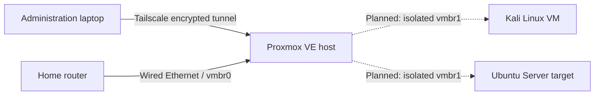

# Home Cybersecurity Lab
Documentation was edited with AI assistance; all configuration work and technical verification were performed by me. I will typically write the lessons learned and observations gained from the study session.

A controlled virtual environment for learning system administration, network isolation, security monitoring, log analysis and defensive detection engineering.

## Project status

This repository preserves my early Proxmox build journal and initial lab plan. Subsequent coursework documents Kali, Windows 7, pfSense, Docker applications, and completed security investigations in the [cybersecurity lab portfolio](https://github.com/RDMRock/cybersecurity-lab-portfolio). The original plans and checklists below describe the build-journal stage, not a current audit of the running environment.

For job-application examples, start with the [web vulnerability fixes](https://github.com/RDMRock/cybersecurity-lab-portfolio/blob/main/case-studies/07-web-vulnerabilities-and-remediation.md), [MCP hardening and regression tests](https://github.com/RDMRock/cybersecurity-lab-portfolio/tree/main/code/mcp-hardening), or my [applied cryptography work](https://github.com/RDMRock/applied-cryptography-labs).

## Purpose

This project documents the construction of a private cybersecurity lab using a dedicated Proxmox VE host.

I am aiming to support:

- Linux administration
- Virtual networking
- Network discovery within an authorized environment
- SSH authentication testing
- Linux log collection and analysis
- Detection engineering
- Incident documentation
- Integration with a Python authentication-event detector

The goal is to build a repeatable environment while documenting both successful changes and troubleshooting decisions. 

Ideally Kali linux will be setup in the next session, and sometime over the next few weeks i'll try some CTF events as well...

## Authorized-use statement

All testing documented in this repository is performed against systems that I own and have explicitly designated as lab targets.

No scanning, authentication testing or security experimentation will be directed at public systems, unrelated devices or networks outside the defined lab environment.

The Ubuntu target will not be exposed through router port forwarding or directly connected to the public internet during exercises.

## Hardware and platform

| Component | Configuration |
|---|---|
| Hypervisor | Proxmox VE 9.2.6 |
| Host memory | 16 GB |
| Host networking | Wired Intel Ethernet |
| Management network | Private home LAN |
| Remote administration | Tailscale |
| Storage | Single local drive using ext4/LVM |
| GPU | Not required for the initial project |

## Architecture



### Management network

The Proxmox host uses `vmbr0`, which is connected to the physical Ethernet adapter and the private home LAN.

The host has a reserved static management address. Remote administration is provided through Tailscale rather than public port forwarding.

### Planned lab network

A second Linux bridge named `vmbr1` will act as an isolated virtual switch.

Planned properties:

- No physical bridge port
- No public gateway
- No router port forwarding
- Static guest addresses within `192.168.56.0/24`
- Kali address: `192.168.56.10/24`
- Ubuntu address: `192.168.56.20/24`
- Ubuntu will have no default gateway during exercises

Kali may temporarily use `vmbr0` for installation and package updates. That connection will be removed or disabled before security exercises begin.

Complete segmentation here to ensure we're operating in a safe environment for anything we're testing.

## Planned virtual machines

| System | vCPU | Memory | Disk | Network |
|---|---:|---:|---:|---|
| Kali Linux | 2–4 | 4 GB | 40 GB | Temporary `vmbr0`, plus isolated `vmbr1` |
| Ubuntu Server | 2 | 2–3 GB | 25 GB | Isolated `vmbr1` only |
| Proxmox host | Shared | Remaining memory | Host storage | Management through `vmbr0` |

The initial environment intentionally avoids memory-heavy security platforms such as Wazuh. These may be added after a memory upgrade or operated separately.

## Security principles

- avoided port forwarding on my home router for the designated ports I used
- DHCP reservation for the proxmox server
- Unnecessary ports properly disabled on home network
- Remote administration requires membership in the private Tailscale network.
- Tailscale Funnel is not enabled.
- MFA WILL BE applied through the Tailscale identity provider.
- Proxmox MFA will provide a second authentication layer.
- Lab targets will not be bridged directly onto the home LAN during exercises.
- Authentication links, passwords, tokens, private keys and recovery codes are never committed.
- Public screenshots are reviewed and cropped before publication.
- Security testing is limited to explicitly authorized lab systems.

## Planned investigation scenario

```text
Kali generates controlled failed SSH logins
        ↓
Ubuntu records the authentication failures
        ↓
The logs are located and examined
        ↓
Events are normalized into a consistent format
        ↓
A Python detector identifies the source and pattern
        ↓
The investigation and false positives are documented
```

This scenario connects virtualization, networking, Linux administration, telemetry and Python detection into one portfolio project.

## Build journal


- [Session 01: Proxmox baseline and secure remote access](docs/session-01-proxmox-baseline.md)
- [Session 02: Ubuntu installation media](docs/session-02-ubuntu-iso.md)
- [Session 03: Ubuntu VM build](docs/session-03-ubuntu-vm-build.md)
- [Session 04: Ubuntu baseline](docs/session-04-ubuntu-baseline.md)
- [Session 05: RHEL media staging](docs/session-05-rhel-media-staging.md)

The initial roadmap included:

- Isolated virtual networking
- Kali installation and hardening
- Ubuntu target configuration
- SSH telemetry generation
- Log investigation
- Python detector integration
- Incident reporting

## Initial milestone checklist

- [x] Select the virtualization platform
- [x] Install Proxmox VE
- [x] Configure stable wired management networking
- [x] Correct non-subscription repository configuration
- [x] Establish private remote administration
- [ ] Confirm MFA and device-approval configuration
- [ ] Create the isolated `vmbr1` network
- [ ] Download and verify installation images
- [ ] Install Kali Linux
- [ ] Install Ubuntu Server
- [ ] Configure SSH logging
- [ ] Generate controlled authentication failures
- [ ] Normalize and analyze events
- [ ] Integrate the Python detector
- [ ] Produce an incident report

## Repository structure

```text
home-cybersecurity-lab/
├── README.md
├── docs/
│   ├── session-00-design.md
│   ├── session-01-proxmox-baseline.md
│   └── images/
├── detections/
├── reports/
└── samples/
```

Only sanitized log samples will be stored in `samples/`. Credentials, tokens and identifying network information will be excluded.

## References

- [Proxmox VE Administration Guide](https://pve.proxmox.com/pve-docs/pve-admin-guide.pdf)
- [Proxmox network configuration](https://pve.proxmox.com/wiki/Network_Configuration)
- [Tailscale on a Proxmox host](https://tailscale.com/docs/integrations/proxmox)
- [Kali virtualization documentation](https://www.kali.org/docs/virtualization/)