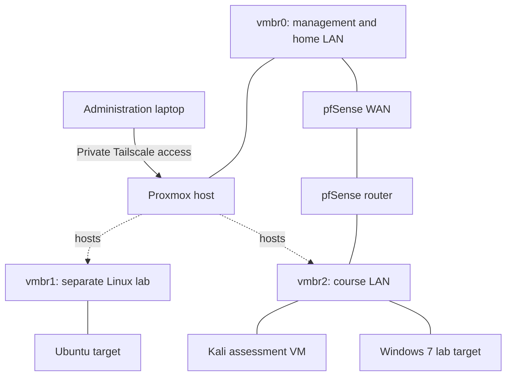

# Proxmox Cybersecurity Lab

I built a home lab to work through security investigations, understand the results, and test fixes. It has grown from an Ubuntu baseline into a course environment with Kali, Windows 7, pfSense, and local web and AI-security applications.

**Start with [the investigation record](docs/course-lab-investigations.md) or [the network design](docs/network-and-recovery.md).** The [coursework portfolio](https://github.com/RDMRock/cybersecurity-lab-portfolio) contains the detailed case studies, code, and selected evidence.

## Completed work

| Area | What I did | Evidence |
| --- | --- | --- |
| Virtualization and administration | Installed Proxmox on a dedicated PC and established private remote administration through Tailscale. | [Initial build journal](docs/session-01-proxmox-baseline.md) |
| Linux baseline | Installed and updated Ubuntu, configured UFW and scoped SSH access, enabled the guest agent, removed temporary update connectivity, and created a powered-off snapshot. | [Verified baseline](docs/session-04-ubuntu-baseline.md) |
| Course network | Used a separate virtual bridge for Kali, Windows 7, and the pfSense LAN. Kept the course endpoints off the management bridge. | [Network and recovery notes](docs/network-and-recovery.md) |
| Vulnerability assessment | Compared Nmap scans and reviewed Nessus findings against the Windows target. | [Reconnaissance and triage](https://github.com/RDMRock/cybersecurity-lab-portfolio/blob/main/case-studies/01-reconnaissance-and-vulnerability-assessment.md) |
| Windows investigation | Validated remote access, process and privilege context, two persistence conditions, and credential-related observations. | [Windows case study](https://github.com/RDMRock/cybersecurity-lab-portfolio/blob/main/case-studies/03-windows-post-exploitation-and-ai-authorization.md) |
| Network and browser analysis | Compared HTTP and HTTPS, inspected certificates and packets, and investigated DNS, CSP, and browser-policy failures. | [Traffic and TLS](https://github.com/RDMRock/cybersecurity-lab-portfolio/blob/main/case-studies/04-network-interception-and-rag-poisoning.md) · [Browser investigation](https://github.com/RDMRock/cybersecurity-lab-portfolio/blob/main/case-studies/06-browser-security-and-mcp-hardening.md) |
| Application remediation | Patched SQL injection, IDOR, SSTI, and unsafe deserialization, then repeated the relevant lab requests. | [Before-and-after evidence](https://github.com/RDMRock/cybersecurity-lab-portfolio/blob/main/case-studies/07-web-vulnerabilities-and-remediation.md) |
| MCP tool hardening | Implemented safer database, Git, and file operations with ten published regression tests. | [Code and test instructions](https://github.com/RDMRock/cybersecurity-lab-portfolio/tree/main/code/mcp-hardening) |

## Documented architecture

`vmbr1` and `vmbr2` have separate purposes. The course LAN has a routed path through pfSense, so it should not be described as air-gapped. The diagram reflects recorded setup and coursework, not a fresh runtime audit. [Configuration details and evidence limits](docs/network-and-recovery.md) explain the boundaries.

## Build journal

1. [Proxmox baseline and private remote access](docs/session-01-proxmox-baseline.md)
2. [Ubuntu installation media](docs/session-02-ubuntu-iso.md)
3. [Ubuntu VM build](docs/session-03-ubuntu-vm-build.md)
4. [Ubuntu update and isolation baseline](docs/session-04-ubuntu-baseline.md)
5. [RHEL media verification](docs/session-05-rhel-media-staging.md)
6. [Course network and recovery work](docs/network-and-recovery.md)
7. [Course investigations and remediation](docs/course-lab-investigations.md)

The [initial plan](docs/archive/initial-lab-plan.md) is preserved as history. The [status record](docs/status-and-sources.md) distinguishes completed work from the monitoring work still planned.

## Related research

- [Cross-cloud detection rule transfer](https://github.com/RDMRock/cross-cloud-detection-transfer): ongoing R&D on preserving detection meaning across cloud providers.
- [Shopify security research](https://github.com/RDMRock/shopify-security-research): independent authorization and AI-security research methodology with offline evidence tooling.
- [Applied cryptography](https://github.com/RDMRock/applied-cryptography-labs): key exposure, ciphertext integrity, and padding-oracle coursework.

## Working approach

The course VMs and deliberately vulnerable applications are designated test targets. Controlled browser and phishing exercises used my lab browser, controlled accounts, and dummy data. I document identity, expected behavior, actual output, retests, and limits rather than treating a tool's success message as proof.

These are academic and personal projects. They demonstrate hands-on investigation and remediation, while a production SIEM deployment and continuous detection pipeline remain future work. AI assisted parts of the lab workflow and documentation; the case studies disclose the relevant assistance and evidence boundaries.
