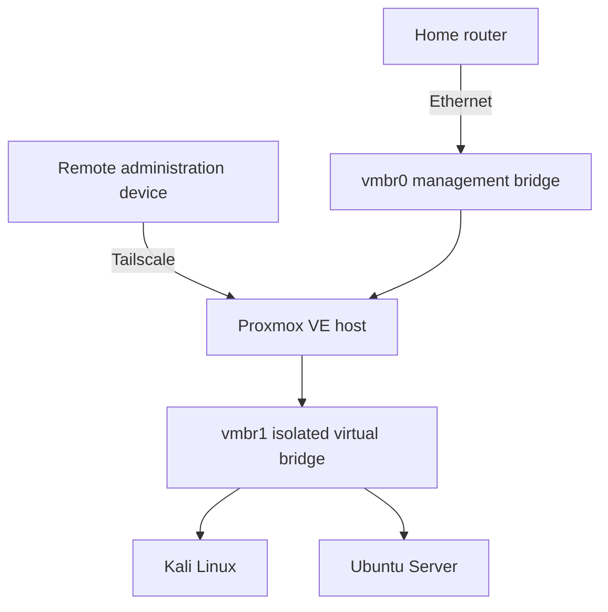

# Session 01: Initial Lab Design

**Date:** August 1, 2026  
**Status:** Setup PC with a 1TB harddrive, formatted and installed proxmox iso with Rufus
**Implementation status:** Initial planning started. Approximately 3/4 of the way through full server and sandbox setup.

## Objective

Design a safe, practical cybersecurity lab that can operate on a PC with 16 GB of memory.

The environment needs to support Linux administration, isolated networking, controlled authentication testing, log analysis and Python-based detection without exposing vulnerable systems to the public internet.

## Starting constraints

The available PC has:

- 16 GB of RAM
- A wired Intel Ethernet adapter
- A local system drive
- No immediate need for GPU passthrough
- Enough resources for two modest Linux virtual machines

Memory is the primary limitation. The environment should therefore begin with Kali Linux and Ubuntu Server rather than adding a full security-monitoring platform immediately.

If RAM wasn't so expensive this wouldn't be an issue.

## Hypervisor decision

I initially considered keeping Windows installed and using VMware Workstation. That approach would have preserved the PC as a normal workstation and provided a straightforward way to run Kali and Ubuntu.

I ultimately chose Proxmox VE because I wanted the PC to become a dedicated virtualization host that could remain available independently of a desktop operating system.

The trade-off is that Proxmox uses the entire machine and requires more deliberate networking and remote-management planning, which is a good little practice too. I prefer working in the mac ecosystem, so having a dedicated server and remotely logging in is preferable curently.

### Decision summary

| Decision | Reason |
|---|---|
| Use Proxmox VE | Provides a dedicated, browser-managed virtualization platform |
| Use the full system drive | Other operating systems will run as guests rather than through dual boot |
| Use wired Ethernet | Proxmox bridges are designed around reliable wired interfaces. Decided against wifi for greater chance of remote stability as well|
| Use ext4/LVM | Simpler for a single-drive beginner lab than an advanced ZFS layout |
| Avoid GPU passthrough | It is unnecessary for networking and log-analysis exercises |
| Defer Wazuh | The host has limited memory |
| Use Tailscale | Provides encrypted remote administration without public port forwarding |

## Planned architecture

## Management network plan

The Proxmox management interface will use a private static address on the home LAN.

The address will also be reserved in the router so that another device cannot receive the same address through DHCP.

Planned management properties:

- Private network: `x.x.x.x/24`
- Proxmox address: `x.x.x.x/24`
- Gateway: the home router
- DNS: the home router
- Hostname: `masked.data.name`
- Physical interface: Intel Ethernet using the `e1000e` driver

The `/24` prefix corresponds to the subnet mask `255.255.255.0`. It means the first three octets identify the network and the final octet identifies a device on that network.

## Isolated lab network plan

The internal lab network will use:

- Bridge: `vmbr1`
- Subnet: `192.168.56.0/24`
- Kali: `192.168.56.10/24`
- Ubuntu: `192.168.56.20/24`
- Physical bridge port: none
- Gateway: none during exercises
- Router port forwarding: none

A Linux bridge without a physical bridge port acts like an internal virtual switch. Guests connected to it can communicate with one another without being placed directly on the home LAN.

Ubuntu will connect only to `vmbr1` after installation.

Kali may temporarily connect to `vmbr0` for installation and updates. The home-LAN adapter will be disconnected before lab exercises so Kali cannot become an accidental route between the isolated target and the rest of the network.

## Resource plan

| System | vCPU | Memory | Disk |
|---|---:|---:|---:|
| Kali Linux | 2–4 | 4 GB | 40 GB |
| Ubuntu Server | 2 | 2–3 GB | 25 GB |
| Proxmox host and reserve | Shared | Approximately 9 GB remaining | Remaining host storage |

The guest disks may be thin-provisioned, but total declared virtual storage must still be monitored to prevent the physical disk from filling.

## Remote-access plan

The Proxmox management interface must not be directly exposed to the public internet.

The following approaches were considered:

1. Router-hosted WireGuard VPN
2. Tailscale installed on the Proxmox host
3. Direct port forwarding

Direct port forwarding was rejected because it would expose the Proxmox web interface or SSH service to internet scanning and attack attempts.

Tailscale was selected because it establishes an encrypted private connection without requiring inbound router ports.

## Authorized-use boundaries

Testing will be restricted to systems owned and controlled as part of this lab.

The following activities are outside of the current project’s scope:

- Scanning public address ranges
- Testing unrelated home devices
- Attempting authentication against third-party services
- Publishing deliberately vulnerable services
- Configuring router port forwarding to lab targets
- Using malware or destructive payloads
- Performing uncontrolled password cracking

Some of these will be of interest - but will be conducted in a safe and legal manner.

The first scenario will use a small number of manually controlled failed SSH logins against the Ubuntu VM.

## Planned first investigation

1. Confirm network communication between Kali and Ubuntu.
2. Identify the SSH service exposed by Ubuntu.
3. Generate a limited number of failed authentication attempts.
4. Locate the corresponding Ubuntu log entries.
5. Explain each relevant log field.
6. Normalize the events into a format accepted by the Python detector.
7. Identify the source address and event count.
8. Document false-positive considerations.
9. Produce a short incident report.

## Risks and mitigations

### Limited memory

Running too many services may cause swapping and poor performance.

**Mitigation:** Start with only Kali and Ubuntu and keep total guest memory below the host’s physical capacity.

### Accidental exposure

Connecting the Ubuntu target to the management bridge could expose it to other home-network devices.

**Mitigation:** Attach Ubuntu only to `vmbr1` after installation and never configure router port forwarding.

### Remote lockout

Incorrect network or MFA configuration could prevent remote administration.

**Mitigation:** Test changes while an existing session remains open and retain physical access to the host.

### Single-drive failure

The initial host has no storage redundancy.

**Mitigation:** Treat snapshots as convenience features rather than backups and export important backups to another physical device.

### Sensitive information in documentation

Screenshots and logs may expose addresses, credentials, tokens or device identifiers.

**Mitigation:** Review and sanitize every artifact before committing it to the public repository.

## Success criteria

The initial design will be considered successfully implemented when:

- Proxmox is reachable through its private management network.
- Remote access works through Tailscale.
- No Proxmox management ports are publicly forwarded.
- `vmbr1` exists without a physical bridge port.
- Kali and Ubuntu can communicate through `vmbr1`.
- Ubuntu cannot reach the public internet during exercises.
- Controlled failed SSH events can be collected and explained.
- The Python detector can process normalized events.

## Next session

Install and baseline the Proxmox host, configure its repositories and establish secure remote administration.
